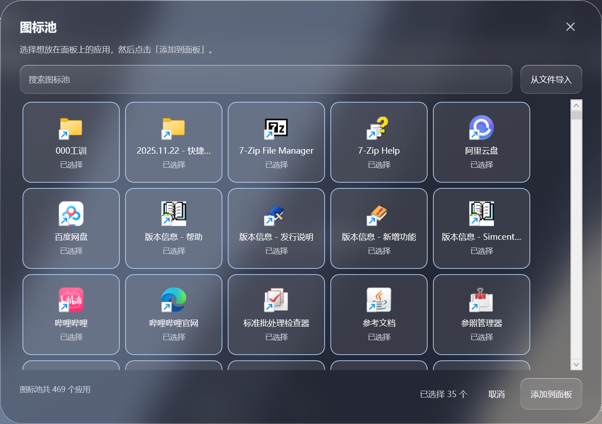
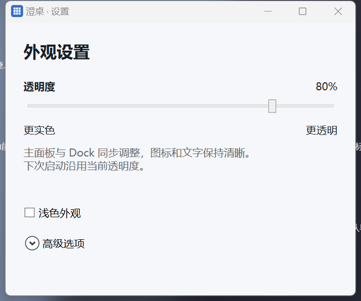

# 澄桌（ClearDesk）

澄桌是 Windows 桌面应用启动器与浮动 Dock。通过手动选择应用、搜索和拖动排序整理常用入口，使用半透明玻璃面板快速启动。

## 软件功能

| 功能 | 当前行为 |
| --- | --- |
| 空面板与图标池 | 首次启动没有应用图标；点击「添加」，从桌面和开始菜单扫描结果中搜索、多选，确认后加入面板 |
| 重复入口合并 | 同一启动目标的重复快捷方式合并；参数、工作目录或权限不同的入口保留 |
| 搜索与分页 | 按名称搜索，每页最多 28 个入口；搜索不会改变保存的顺序 |
| 整理与移除 | 同页拖动时图标让位；Escape 取消排序；右键调整顺序或移除，源文件保持完整 |
| 快速启动 | 点击应用、文件或文件夹，通过 Windows Shell 按原快捷方式和文件关联打开 |
| 浮动 Dock | 设置可选固定排序或最近使用，最多 8 个入口；九宫格单击切换面板，按住九宫格或空白处移动 Dock |
| Dock 大小 | 右侧把手、右键菜单或 Ctrl + 滚轮调整大小，位置和尺寸自动保存 |
| 玻璃外观 | 半透明背景模糊与四角圆角，设置中实时调整透明度，下次启动沿用上一次的值 |
| 托盘常驻 | 所有窗口不显示任务栏按钮；最小化只收起面板、保留 Dock；关闭或 Escape 隐藏全部窗口，托盘可恢复或退出 |
| 重复启动 | 再次启动恢复已有窗口，避免重复创建窗口和托盘图标 |

详细操作和限制见 [使用说明](docs/FEATURES.md)。

## 当前状态

- 阶段：P1 技术验证，已有可运行的玻璃窗口原型。
- 首发平台：Windows 11；系统背景材质首先验证 Windows 11 22H2 及以上。
- 当前技术：C#、.NET 10、WPF、Win32/Shell COM、Windows Composition 与 JSON；SQLite 和正式模块拆分属于后续计划。
- 界面框架决策：WPF 的背景模糊已有本机截图证据；胶囊阴影、命中与多屏验证完成后再最终确认。
- `ClearDesk.sln` 当前包含 `experiments/GlassWindow`；正式 `src/` 与核心测试项目仍是目录骨架。
- 本机已准备项目内 .NET SDK 10.0.401；没有更改系统 SDK 安装或全局 PATH。

## EXE 免安装版

在 Windows 11 22H2 及以上 x64 系统中，双击 `artifacts/releases/ClearDesk.exe` 即可使用，无需另装 .NET 10。首次自动展开运行文件到 `%LocalAppData%\ClearDesk\packages\`，个人设置保存在 `%LocalAppData%\ClearDesk\data\`，发布包不包含开发配置。

另提供 `artifacts/releases/ClearDesk-Online.exe` 轻量版，约 9.4 MiB，比完整离线版小 86.5%。它保留澄桌程序及玻璃组件，首次启动从微软官网下载约 72.6 MiB 的 .NET 运行时，显示进度并校验 SHA-512；缓存后可离线使用。无需管理员权限，不修改系统 .NET，个人设置与离线版共用。这里减少的是分发文件体积，运行时仍需要本地磁盘空间。

从源码生成 EXE：

```powershell
powershell -NoProfile -ExecutionPolicy Bypass -File .\scripts\package.ps1
powershell -NoProfile -ExecutionPolicy Bypass -File .\scripts\package-online.ps1
```

输出包含单文件 EXE、SHA-256 校验文件；具体打包方式见 [开发指南](docs/DEVELOPMENT.md)，本机验证见 [离线版打包记录](docs/evidence/2026-10-12-portable-exe.md) 和 [轻量版验证](docs/evidence/2026-10-12-online-exe.md)。发布产物保存在本地，不进入 Git。

## 启动原型

当前电脑可直接双击 [start.cmd](start.cmd)，或从仓库根目录执行：

```powershell
powershell -NoProfile -ExecutionPolicy Bypass -File .\scripts\run.ps1
```

首次克隆且尚未准备 SDK 时，先运行 `scripts/setup-sdk.ps1`。验证版首次启动为空面板，通过「添加」从图标池搜索、多选并加入应用；支持搜索分页、同页拖动让位、文件路径导入和 Dock 启动。详情见 [实验说明](experiments/GlassWindow/README.md)。

自动检查与截图：

```powershell
powershell -NoProfile -ExecutionPolicy Bypass -File .\scripts\run.ps1 -Verify
```

验证会短暂显示自有窗口并自动退出。追加 `-InputTest` 可检查实际鼠标排序、Dock 移动和缩放；测试拦截外部启动，并恢复鼠标。最新结果见 [启动与最小化验证](docs/evidence/2026-10-12-startup-and-minimize.md)。

面板使用带圆角裁切的 Windows Composition 背景模糊，启动器为 32 DIP、Dock 默认 40 DIP，Dock 缩放时轮廓同步调整；玻璃与窗口边界一致，见 [圆角玻璃验证](docs/evidence/2026-10-11-clipped-backdrop.md)。





## 文档入口

| 文档 | 内容 |
| --- | --- |
| [软件功能与使用说明](docs/FEATURES.md) | 添加图标、启动、整理、Dock、设置和托盘操作 |
| [产品范围](docs/PRODUCT.md) | MVP、交互约定与后续能力 |
| [技术架构](docs/ARCHITECTURE.md) | 模块边界、数据模型与 Windows 集成 |
| [开发指南](docs/DEVELOPMENT.md) | 环境准备、目录约定、Git 工作流 |
| [阶段计划](docs/ROADMAP.md) | 任务状态、依赖与交付标准 |
| [技术验证](docs/VALIDATION.md) | 玻璃窗口、Shell、Dock、多屏验证 |
| [技术决策 ADR-0001](docs/decisions/0001-platform-and-stack.md) | 选型依据与切换条件 |
| [变更记录](docs/CHANGELOG.md) | 已完成的项目变更 |

## 项目目录

```text
cleardesk/
├── README.md
├── ClearDesk.sln
├── global.json
├── start.cmd
├── .editorconfig
├── .gitattributes
├── .gitignore
├── docs/
│   ├── README.md
│   ├── PRODUCT.md
│   ├── ARCHITECTURE.md
│   ├── DEVELOPMENT.md
│   ├── ROADMAP.md
│   ├── VALIDATION.md
│   ├── CHANGELOG.md
│   ├── decisions/
│   │   └── 0001-platform-and-stack.md
│   └── evidence/
│       └── 首轮验证记录、报告与窗口截图
├── scripts/
│   ├── common.ps1
│   ├── setup-sdk.ps1
│   ├── build.ps1
│   └── run.ps1
├── src/
│   ├── ClearDesk.App/
│   │   └── .gitkeep
│   ├── ClearDesk.Core/
│   │   └── .gitkeep
│   └── ClearDesk.Infrastructure/
│       └── .gitkeep
├── experiments/
│   ├── GlassWindow/
│   │   ├── ClearDesk.GlassWindow.csproj
│   │   ├── README.md
│   │   └── WPF 窗口、原生适配、索引与验证源码
│   ├── ShellIntegration/
│   │   └── .gitkeep
│   └── DockBehavior/
│       └── .gitkeep
├── tests/
│   └── ClearDesk.Core.Tests/
│       └── .gitkeep
└── assets/
    └── .gitkeep
```

Git 不追踪空目录，因此用 `.gitkeep` 保留尚未实现的模块。首次创建模块文件时可删除对应占位文件。

## 下一步

继续检查胶囊阴影、系统透明设置降级、多屏 DPI 与外部 Shell 启动语义，再提取正式应用模块。当前不支持独立 Dock 固定项、跨屏摆放、自动隐藏、开机自启、全局快捷键或打包应用枚举。
