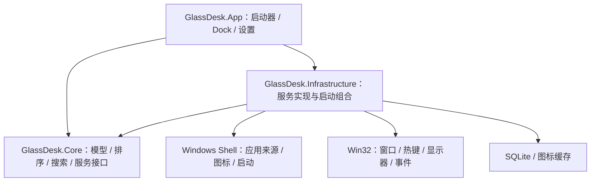

# 技术架构

## 总体方案

采用本地优先的 Windows 桌面架构。WPF 承担界面与输入，Core 定义业务规则和接口，Infrastructure 负责 Windows 与数据适配。

这些项目尚未生成。依赖方向是后续创建解决方案时的约束：Core 不引用 WPF、Windows API 或 SQLite；App 在启动时组合服务；Infrastructure 实现 Core 接口。

## 模块职责

| 模块 | 主要职责 |
| --- | --- |
| GlassDesk.App | MVVM、窗口、视图模型、网格布局、拖动反馈、主题 |
| GlassDesk.Core | 启动入口模型、搜索规则、候选排序、配置模型与服务接口 |
| GlassDesk.Infrastructure | Shell COM、原生窗口服务、热键、持久化、缓存、日志 |
| experiments/GlassWindow | 材质、圆角、阴影与命中区域验证 |
| experiments/ShellIntegration | 入口枚举、图标读取、拖入与启动验证 |
| experiments/DockBehavior | 焦点、显隐、窗口激活与显示环境验证 |
| GlassDesk.Core.Tests | 有实际意义的排序、搜索和数据规则测试 |

## 窗口与材质

- 启动器、Dock 和设置采用独立窗口，共享服务和数据。
- 启动器允许输入；Dock 的显现与悬停采用不主动激活的行为。
- WPF 首先验证非 layered 原生 HWND 与 DWM 背景材质的组合。
- Windows 11 22H2+ 的 `DWMWA_SYSTEMBACKDROP_TYPE` / `DWMSBT_TRANSIENTWINDOW` 是 Desktop Acrylic 的文档化验证路线。
- `AllowsTransparency=true` 会改变窗口渲染路径，不能假定与系统材质、阴影和圆角无条件兼容。
- DWM 默认圆角不等于参考图的大圆角胶囊；轮廓、裁切、透明区命中和阴影必须一起验证。
- Mica 主要依据壁纸形成材质，不能直接作为任意下层窗口内容的实时模糊方案。
- 系统材质不可用时，使用产品允许的降级外观。

若 WPF 验证不能达到核心要求，评估 WinUI 3 的 `DesktopAcrylicBackdrop`，保留 Core 和 Infrastructure。框架切换依据记录到 ADR。

## 启动入口

建议的逻辑模型如下；字段和数据库表在 Shell 验证后定稿。

| 模型 | 核心字段 |
| --- | --- |
| LaunchEntry | Id、DisplayName、LaunchKind、SourcePath、Target、Arguments、WorkingDirectory、AppUserModelId、IconCacheKey |
| LauncherPlacement | EntryId、SortOrder；页号由当前网格容量计算 |
| DockPlacement | EntryId、SortOrder |
| AppSettings | 主题、材质、图标大小、快捷键、可选启动设置 |

`LaunchKind` 区分快捷方式、文件/目录、协议、可执行文件和打包应用。保留原始快捷方式路径，通过 Shell 启动时保留它的参数和工作目录；解析后的信息主要用于展示和匹配。

桌面与开始菜单路径通过 Known Folder API 获取；打包应用从 AppsFolder 枚举并按 AUMID 启动。导入重复项的判定需结合入口类型和完整启动描述，不能只比较 exe 文件名。

外部拖入首轮支持文件路径类数据，Shell 虚拟项目另行验证。图标使用 Shell 图标接口提取，后台读取并缓存；损坏或失效入口保持可编辑，并给出状态反馈。

## 拖拽排序

维护已提交顺序与拖动中的候选顺序。只有候选插入位变化时更新布局目标，逐帧动画只改变 Transform。快速改变方向时取消旧动画并从当前视觉位置继续。

松手后以事务保存最终顺序；取消操作不写入数据库。窗口尺寸或网格容量变化时重算分页，避免排序依赖物理像素或固定页号。

## 系统适配

- 以 Per-Monitor V2 DPI 为目标，在第一个窗口实验中确认清单与运行时行为；处理负屏幕坐标和混合缩放。
- 全局热键采用注册机制，冲突时反馈并允许更换。
- 初始运行状态通过窗口枚举建立，后续使用 WinEvent 事件更新；识别可见性、cloaked 状态和应用标识。
- 不依赖启动时返回的 PID 判定全部运行状态，不仅按进程名归组。
- 激活已有窗口遵守 Windows 前台权限规则；无法切换时提供可理解的反馈。
- 浮动 Dock 默认不预留系统工作区；若后续需要预留空间，评估 AppBar。
- 处理显示器拔插、主屏切换、任务栏变化、Explorer 重启和休眠恢复。

## 数据与线程

运行数据计划存储在 `%LocalAppData%\GlassDesk\`，SQLite 数据、图标缓存和日志分目录保存。UI 线程只承担界面工作；COM/Shell 操作按其线程模型执行，使用后台 STA 工作线程时不得直接跨线程传递 COM 对象。

数据库迁移带版本号，迁移前备份；配置写入和排序写入使用事务。首次实现时定义日志轮转策略，避免记录敏感启动参数。当前尚未创建数据库或应用数据目录。
