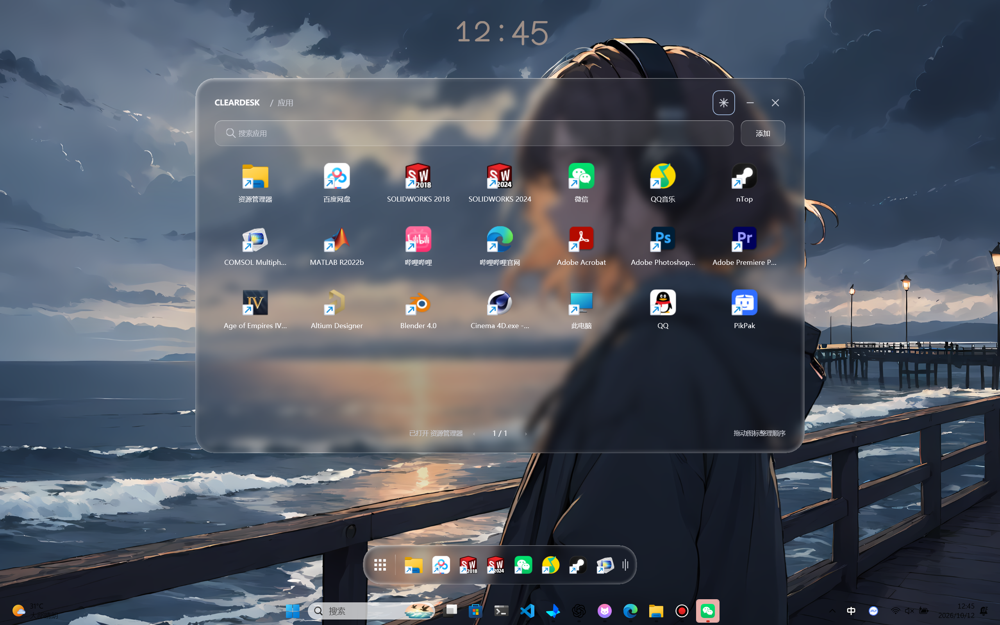
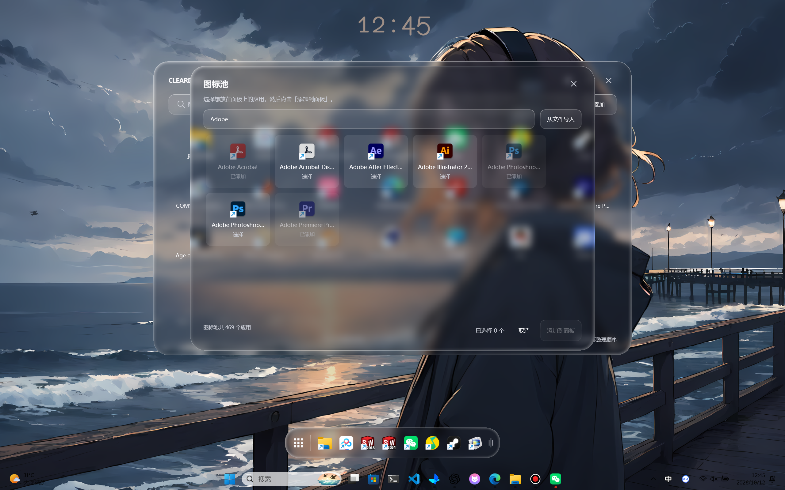
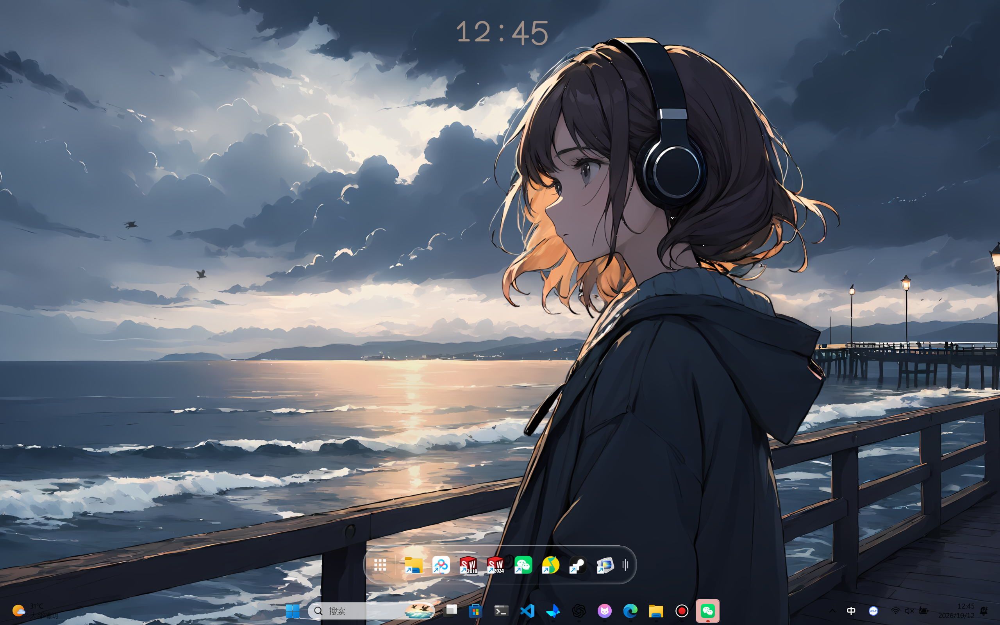
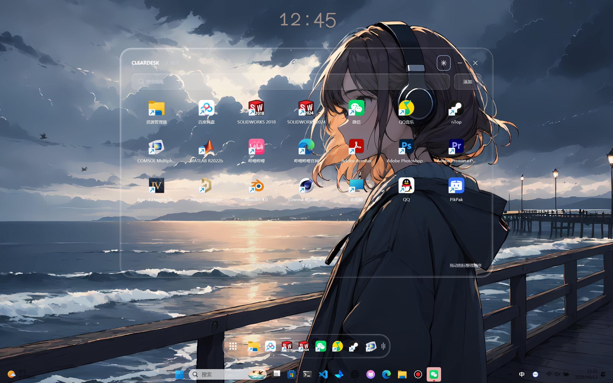
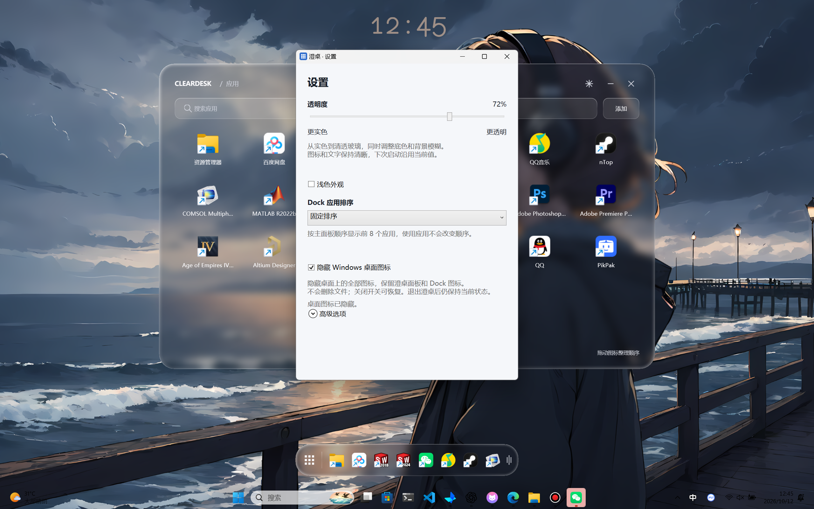

# 澄桌功能与使用说明

更新日期：2026-10-12。适用版本：仓库中的 Windows 11 x64 可运行原型。

澄桌将用户选择的启动入口放入玻璃面板，底部浮动 Dock 提供常用应用的快捷入口。软件常驻系统托盘，不显示任务栏按钮。

本文配图均为 2560 × 1600 的完整桌面实拍，保留壁纸与任务栏。截图中已有的应用为手动添加示例，首次使用仍从空面板开始。拍摄环境与场景见 [截图说明](screenshots/README.md)。

## 启动与添加应用

**EXE 用户**：在 Windows 11 22H2+ x64 中双击 `ClearDesk.exe`（离线版），或 `ClearDesk-Online.exe`（轻量版）。离线版约 69.5 MiB，自带运行时；轻量版约 9.4 MiB，首次联网下载微软运行时，缓存后可离线使用。两种版本共用个人设置。

**源码用户**：首次使用先运行 `scripts/setup-sdk.ps1` 准备项目内 SDK，再双击根目录 `start.cmd`。已有 SDK 时直接双击即可。重复启动会恢复正在运行的澄桌。

1. 首次主面板为空，Dock 仅显示左侧九宫格按钮。
2. 点击面板右上角「添加」，打开图标池。
3. 搜索并勾选需要的应用，点击「添加到面板」。关闭或取消图标池不会添加。
4. 下次启动只显示之前手动添加的入口，不会把扫描到的全部应用自动加入。

图标池扫描桌面与开始菜单快捷方式，相同启动描述的重复入口合并。需要添加未扫描到的文件或文件夹时，可在图标池导入，或拖入主面板，再确认选择。未确认的外部候选仅在当前会话保留。

## 搜索、启动与整理

主面板支持按名称搜索，每页最多 28 个入口。点击图标由 Windows Shell 打开原快捷方式、文件或文件夹，保留原快捷方式的启动语义。

同页拖动图标可调整顺序，邻近图标平滑让位，松手保存；拖动过程中按 Escape 取消，恢复原顺序。搜索视图不允许改变原排序。右键图标可前后移动或「从面板移除」，移除不会删除磁盘上的原文件，之后可从图标池重新加入。

## Dock 操作

| 操作 | 效果 |
| --- | --- |
| 单击九宫格 | 显示或隐藏主面板 |
| 按住九宫格拖动 | 移动整个 Dock，松开不触发面板切换 |
| 拖动空白区域 | 移动 Dock |
| 点击应用图标 | 启动对应入口 |
| 拖动右侧把手 | 向右放大，向左缩小 |
| Ctrl + 滚轮 | 调整 Dock 大小 |
| 右键菜单 | 放大、缩小、默认大小，以及左下、底部中央、右下位置预设 |

在「设置 → Dock 应用排序」选择排序方式，立即生效并保存，下次启动沿用：

- **固定排序**：默认选项，按主面板顺序显示前 8 个应用，启动应用不会改变 Dock 顺序。整理主面板顺序即可调整固定显示顺序。
- **最近使用**：通过澄桌主面板或 Dock 成功启动的应用排在前面，未使用的按主面板顺序补齐，最多显示 8 个。固定模式下也记录使用，因此切换后可立即使用已有记录。

最近使用仅统计通过澄桌启动的入口，不读取其他软件的使用记录；启动失败不更新顺序，已移除的应用不会因历史记录重新出现。两种模式不改动主面板顺序。Dock 尚无独立固定列表。

默认尺寸 620 × 88 DIP，范围为 65%–160%，最大尺寸也受屏幕宽度限制。位置和尺寸自动保存；目前只允许在主屏工作区域内移动。

*图中只收起主面板，Dock 可以继续启动应用，或通过左侧九宫格恢复面板。*

## 透明度与设置

点击主面板右上角「设置」，拖动透明度滑动条。0% 为实色底色，100% 为接近清透的玻璃；百分比越高，底色越透明、背景模糊越弱。主面板、Dock 和图标池同步调整，文字与图标保持清晰。玻璃边缘增加向内渐变的切面高光与暗部，轮廓外不增加第二层圆角。当前切面通过光影模拟，不扭曲背景图像。

透明度实时生效，停止调整后自动保存，下次启动沿用最后一次值，不重置默认值。设置也提供浅色外观，高级选项包含材质切换、圆角裁切与窗口诊断。实色模式或系统透明效果不可用时，透明度滑动条不可用，但保存的透明度偏好保留。当前持久化的外观偏好为透明度，主题和材质切换尚不持久化。

*与页首 72% 的磨砂效果使用同一张桌面壁纸，可直接比较背景细节和模糊程度。*

## 隐藏 Windows 桌面图标

在设置中打开「隐藏 Windows 桌面图标」，桌面上的全部图标会隐藏，澄桌主面板和 Dock 中的图标保留。关闭开关即可恢复显示；桌面文件和快捷方式不会被删除或移动，图标池仍可扫描这些入口。

这是 Windows 的桌面显示设置，退出澄桌后仍保持当前状态，下次打开设置会读取实际状态。也可在桌面右键 → 查看 → 显示桌面图标中调整；回到澄桌设置时会同步。资源管理器暂时不可用时开关禁用，等待恢复后重新打开设置即可。

## 收起、恢复与退出

| 操作 | 效果 |
| --- | --- |
| 右上角横线最小化 | 隐藏主面板及附属设置/图标池，Dock 保持显示 |
| Dock 九宫格 | 恢复收起的主面板 |
| 右上角关闭、Alt+F4 | 隐藏全部窗口，继续后台运行 |
| 非拖动状态下 Escape | 隐藏全部窗口 |
| 点击托盘图标 | 恢复主面板与 Dock |
| 托盘右键「隐藏全部窗口」 | 收起全部窗口 |
| 托盘右键「退出澄桌」 | 彻底退出并清理托盘图标 |

托盘图标是否位于通知区域「^」内由 Windows 设置决定。Explorer 暂时不可用时会重试托盘注册，保留可用窗口，避免隐藏后无法找回。

## 本地数据与当前限制

源码运行的实验数据保存在 `artifacts/GlassWindow/`；EXE 版个人数据保存在 `%LocalAppData%\ClearDesk\data\`。两个目录使用相同的数据文件：

| 文件 | 内容 |
| --- | --- |
| `panel-state.json` | 手动添加的入口及顺序 |
| `dock-layout.json` | Dock 位置和缩放比例 |
| `appearance-settings.json` | 最后设置的透明度 |
| `dock-preferences.json` | Dock 排序模式与最近启动记录 |

这些本地配置不推送 GitHub。旧 `state.json` 保留但不自动迁移到新面板。

当前需要 Windows 11 22H2+、x64 与 .NET 10 运行环境。独立 Dock 固定项、跨页拖动、自动隐藏、多屏布局、开机自启、全局快捷键、运行中窗口切换、AppsFolder 打包应用枚举、安装包和自动更新尚未交付。
